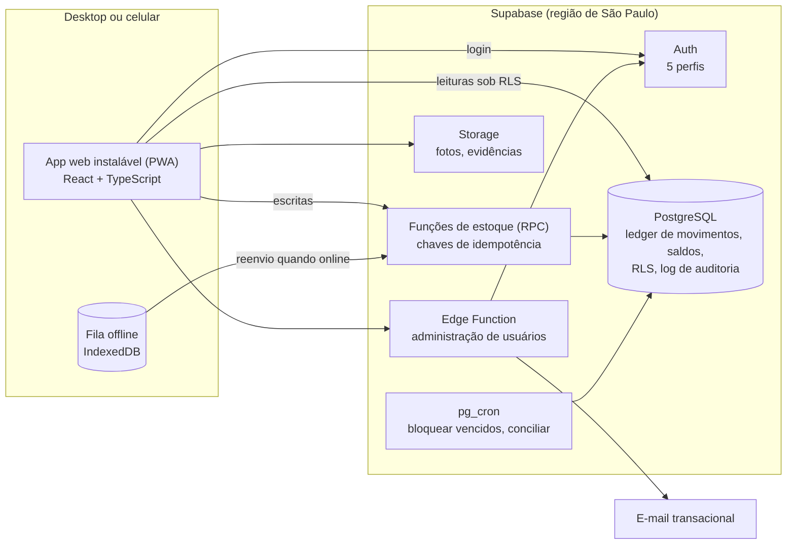

# Provide · Controle de estoque para home care, do banco de dados ao app instalável

Sistema de controle de estoque para a operação de home care da Provide Saúde, empresa brasileira de saúde que entrega insumos médicos e medicamentos na casa dos pacientes. Ele substitui planilhas por um único ledger para todos os itens, lotes e locais, do almoxarifado central a ambulâncias, eventos e domicílios de pacientes. Construí o banco de dados, a lógica de negócio, o modelo de segurança e o app inteiro como único desenvolvedor do projeto na Kavicki.

> Este repositório é um estudo de caso, não um repositório de código. O código-fonte pertence ao cliente e continua privado. As telas e os vídeos usam somente dados fictícios: nenhum paciente, funcionário ou estoque real. Tudo o que está aqui descreve o meu próprio trabalho, em um nível de detalhe que posso aprofundar em entrevista.

---

## Visão geral

| | |
|---|---|
| **Meu papel** | Único desenvolvedor: modelo de dados, lógica e segurança do banco, função de backend, o app inteiro, deploys |
| **Período** | Outubro de 2026 até hoje (Módulo 1 de 2) |
| **Status** | Em produção como app web instalável, com as duas primeiras entregas liberadas: fundação, cadastros, migração das planilhas e inventário inicial; depois recebimento, saída, quarentena e validade |
| **Stack** | Supabase (PostgreSQL 17, Auth, Row Level Security (RLS), Storage, Edge Functions, pg_cron), React 19, TypeScript, Vite, styled-components, TanStack Query, React Hook Form, Zod, IndexedDB, Vitest, Testing Library, pgTAP |
| **Código** | 18 migrations SQL · 35 componentes de tela · 501 asserções de banco (pgTAP) e 382 testes de app (Vitest) |

## O problema

A operação de home care da Provide abastece pacientes em casa com curativos, cateteres, soluções e medicamentos. O estoque vivia em planilhas espalhadas por três almoxarifados (central de home care, licitação e medicamentos). Planilhas não respondem às perguntas que importam na saúde:

- **Qual lote foi para onde?** Duas caixas do mesmo item com validades diferentes não são o mesmo estoque.
- **O que está realmente disponível?** Material já prometido ao pedido de um paciente não pode ser prometido duas vezes.
- **O que vence, e quando?** Um lote vencido precisa deixar de ser usado sem que alguém tenha que lembrar.
- **Onde está o material?** Insumos enviados a uma ambulância ou a um evento continuam sendo da empresa até serem usados.

O sistema precisava dar a cada um dos cinco perfis operacionais (gestor, almoxarifado, enfermagem, entregador e aprendiz) exatamente o que o trabalho dele exige, no desktop do almoxarifado e no celular em campo.

## Restrições

- **Equipe:** um desenvolvedor (eu) para banco, backend e app. O design e a biblioteca de componentes vieram da equipe da Kavicki (ver [Equipe e créditos](#equipe-e-créditos)).
- **Dados de saúde:** os registros de pacientes estão sujeitos à LGPD, a lei brasileira de proteção de dados. O banco roda no Brasil, o acesso é filtrado por perfil e por local dentro do próprio banco, e toda mudança em estoque, lotes ou cadastros vai para um log de auditoria imutável.
- **Dispositivos:** desktops de escritório, além de iPhones e celulares Android. Sem loja de apps: o cliente recebe um app web instalável (PWA).
- **Conectividade:** a contagem e, mais adiante, a entrega acontecem em lugares com sinal fraco ou sem sinal. O trabalho registrado no celular não pode se perder quando a rede cai.
- **Contrato:** escopo fechado dividido em entregas, cada uma utilizável por si só e aceita pelo cliente dentro de uma janela de revisão. Parâmetros de negócio (faixas de validade, estoque mínimo) são configuração, não escopo novo.

## O que construí

**Banco de dados e lógica de negócio**
- Um ledger de movimentos como única fonte de verdade, com saldo por item, lote e local em três camadas: físico, reservado e disponível (ver [ADR 0001](docs/adr/0001-saldo-derivado-do-ledger-de-movimentos.md)).
- Toda operação de estoque como função de banco com chave de idempotência: recebimento contra nota fiscal do fornecedor, saída, transferências, devoluções de paciente, descartes, avaliação de quarentena, fechamento de evento, contagens cegas e estornos (ver [ADR 0002](docs/adr/0002-regras-de-estoque-em-funcoes-do-banco.md)).
- FEFO (first expired, first out: o que vence primeiro sai primeiro): o sistema sugere o lote que vence primeiro, e qualquer outra escolha exige uma justificativa escrita que vai para o log de auditoria.
- Jobs agendados que bloqueiam lotes vencidos na virada do dia e recalculam todos os saldos a partir dos movimentos, sinalizando qualquer divergência ao gestor.
- Row Level Security por perfil e por local, log de auditoria imutável e buckets de storage para fotos de itens e evidências (fotos, relatórios).

**App (desktop e celular)**
- Cadastros: itens com foto, unidades de compra e de consumo com fator de conversão, fornecedores, pacientes, contratos, locais de estoque e kits.
- Migração das planilhas do cliente: leitura no próprio dispositivo, mapeamento de colunas com prévia exata antes de gravar qualquer coisa e revisão de prováveis duplicados que funde itens sem mexer nos movimentos passados.
- Inventário inicial com contagem cega no celular (quem conta nunca vê a quantidade esperada), registrado por uma fila offline que reenvia automaticamente.
- Recebimento em três etapas (nota, itens, conferência) com lote e validade obrigatórios, recusa de lotes vencidos, confirmação para validade curta e tratamento de divergências de recebimento.
- Quarentena, saída manual com FEFO, devoluções de paciente, descartes com evidência, transferências entre estoques, compras de passagem, visões de saldo, dashboard com faixas de validade, gestão de usuários com senhas temporárias e log de auditoria com exportação em CSV.

**Função de backend e entrega**
- Uma Edge Function para o que precisa de segredo: criar usuários com senha temporária e enviar o e-mail de acesso.
- Recuperação de senha por e-mail, e o PWA gerado como arquivos estáticos com app shell offline.

## Arquitetura

- O app lê tabelas e views diretamente, e a Row Level Security decide o que cada perfil e local pode ver.
- O app nunca escreve nas tabelas de estoque. Toda escrita é uma função de banco que verifica o perfil, valida as regras e grava movimentos, saldos e entradas de auditoria em uma única transação.
- Cada escrita carrega uma chave de idempotência gerada no dispositivo, então a fila offline pode reenviar depois de uma queda de rede sem duplicar nada.
- Dois jobs noturnos rodam dentro do banco: um bloqueia lotes vencidos, o outro recalcula os saldos a partir dos movimentos e registra qualquer diferença sem corrigi-la em silêncio.

## Principais decisões e trade-offs

| Decisão | Alternativas consideradas | Por quê | Custo aceito |
|---|---|---|---|
| Saldo derivado de um ledger de movimentos insert-only ([ADR 0001](docs/adr/0001-saldo-derivado-do-ledger-de-movimentos.md)) | Uma coluna de saldo editável, ou um saldo calculado só na leitura | Todo número tem explicação, e uma reserva pode travar a linha do lote para que o mesmo item nunca seja prometido duas vezes | Uma tabela de saldos mantida por triggers que nunca pode divergir, protegida por uma conciliação noturna |
| Regras de estoque ficam em funções do banco ([ADR 0002](docs/adr/0002-regras-de-estoque-em-funcoes-do-banco.md)) | Um servidor de API, ou regras no app só com RLS | Uma transação por operação, as mesmas regras para qualquer client, retentativas seguras a partir da fila offline | A maior parte da lógica de negócio é SQL, então a suíte de testes do banco carrega o peso |
| Ambulâncias, eventos, domicílios de pacientes e quarentena são locais de estoque ([ADR 0003](docs/adr/0003-destinos-e-quarentena-sao-locais.md)) | Tratá-los como saídas, ou como status no lote | O material continua sendo da empresa até ser consumido, e um único ledger responde "onde está" em todos os casos | Mais locais para proteger, e eventos precisam ser fechados explicitamente |
| PWA instalável sobre a biblioteca de componentes da equipe ([ADR 0004](docs/adr/0004-pwa-sobre-a-biblioteca-de-componentes-da-equipe.md)) | Manter a primeira versão em Expo / React Native Web, ou um app de loja | Uma biblioteca de componentes para toda a equipe, já validada contra o design, e sem distribuição por loja | A primeira camada de UI e sua suíte de testes foram reescritas |

## Do design ao código

A equipe de design da Kavicki entregou o protótipo no Figma pronto (50 telas de desktop, a versão para celular de cada uma e uma página de componentes), e um colega construiu a biblioteca de componentes web a partir dele. Construí o produto inteiro sobre essa base, conferindo cada tela contra o Figma no desktop e no celular.

## Desafios

### Fila offline sem duplicar estoque

A contagem acontece em lugares com sinal fraco ou sem sinal, e a fila do celular reenvia o trabalho quando a rede volta. Um reenvio não pode lançar o mesmo movimento duas vezes, e o mesmo item não pode ser prometido a dois pedidos. Cada escrita é uma função de banco que recebe uma chave de idempotência gerada no dispositivo: repetir a chamada com a mesma chave devolve o resultado original sem gravar de novo. A reserva trava a linha do lote dentro da transação, e um job noturno recalcula todos os saldos a partir do ledger e registra qualquer diferença para o gestor. Os testes de banco corrompem um saldo de propósito para provar que a conciliação pega a diferença.

### As planilhas reais do cliente

As planilhas do cliente fugiam de qualquer formato padrão: linhas soltas acima do cabeçalho, uma linha de "total" no final, texto livre onde se esperavam números e colunas com nomes genéricos como "Coluna2". O leitor escolhe o cabeçalho entre as primeiras linhas comparando com nomes de coluna conhecidos, deixa o usuário sobrescrever a escolha e ignora linhas de total. Os nomes de coluna casam por inteiro e por prioridade, para que "código de barras" nunca seja confundido com o código interno. As quatro planilhas foram conferidas no navegador contra a prévia.

## Resultados

- Duas entregas em produção como app web instalável: a primeira, usada pelo cliente no inventário inicial, e a segunda, com recebimento, saída, quarentena e validade.
- O estoque das planilhas passa para um ledger em que cada saldo pode ser rastreado até os movimentos que o criaram, por item, lote e local.
- Lotes vencidos são bloqueados automaticamente toda noite, e os saldos são conciliados com o ledger toda noite.

## Próximos passos

O Módulo 2 adiciona leitura de código de barras e QR pela câmera do celular, ordens de serviço com separação por leitura e entrega com assinatura, foto e localização, funcionando totalmente offline.

## Como trabalho

Fui dono deste produto de ponta a ponta. Transformei o contrato e o protótipo em um design técnico, defini o modelo de dados e o modelo de segurança, tomei todas as decisões técnicas e levei cada entrega até a produção. Questões que dependem da operação do cliente (quem aprova um pedido, o que acontece quando falta um item) foram para o cliente em um questionário escrito, e as respostas moldaram o modelo.

Meu processo foi montado para manter a qualidade alta entregando como único desenvolvedor:

- **Especificação primeiro.** Cada entrega começa com um documento de design e um plano de implementação que eu escrevo e aprovo: escopo, invariantes, permissões e casos de borda, antes de existir qualquer código. Cada plano termina com uma seção que registra todo desvio feito durante a execução, para que os documentos batam com o que foi construído.
- **Testes em todas as camadas.** 501 asserções de banco em pgTAP cobrem a imutabilidade do ledger, saldos após cada tipo de movimento, RLS por perfil e local, o log de auditoria e regras estruturais (toda tabela tem RLS, nada é concedido a usuários anônimos, nenhuma função usa a data do servidor). 382 testes do app em Vitest e Testing Library cobrem telas, hooks de dados e a fila offline. Um teste lê as migrations e falha se algum código de erro do banco não tiver mensagem para o usuário.
- **Revisão de toda mudança.** Cada tarefa passa por uma revisão contra o plano e o design, e os achados são corrigidos antes de seguir.
- **Assistido por IA, sob minha responsabilidade.** Uso agentes de código para acelerar a implementação de tarefas que já especifiquei. Reviso cada diff, rejeito o que não segue o plano e mantenho o modelo de dados, a segurança, as regras de estoque e todas as decisões de produto sob meu controle direto.
- **Operação segura.** A produção é verificada com consultas somente leitura e nada chega à produção sem minha aprovação explícita. Antes de uma migration sair, confiro em produção se as premissas dela se sustentam.

## Equipe e créditos

- **Design:** o protótipo no Figma foi fornecido pronto para construir pela equipe de design da Kavicki.
- **Biblioteca de componentes:** um colega da Kavicki construiu a biblioteca de componentes web a partir do mesmo arquivo do Figma, validada pixel a pixel em todas as variantes desenhadas. Construí o produto inteiro sobre ela: todas as telas e fluxos, navegação, estado e camada de dados, a fila offline, o banco de dados, a segurança e os deploys.
- **Produto:** prioridades e regras de negócio foram definidas junto com o cliente.

## Por que não há código aqui

O código pertence ao cliente. Em uma entrevista técnica, posso percorrer qualquer parte do sistema, incluindo o modelo de dados, as funções de estoque, o modelo de segurança e o app, dentro dos limites desse acordo.

---

Contato: [LinkedIn](https://www.linkedin.com/in/gabriel-souza-fernandes/) · [GitHub](https://github.com/Fergab1)
